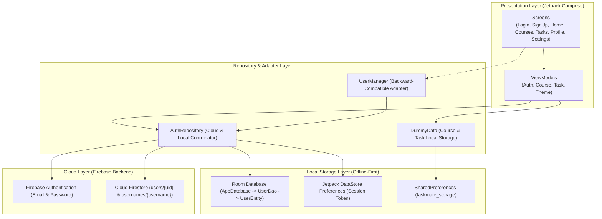

# TaskMate — Student Task & Course Management Application

> **Mata Kuliah**: Pemrograman Aplikasi Perangkat Bergerak (PAPB) — Kelas D  
> **Kelompok**: Kelompok 9  
> **Tujuan**: Proyek Tugas Kelompok & Ujian Akhir Praktikum (UAP)  
> **Platform**: Android (Min SDK 26, Target SDK 35)

---

## Daftar Isi
1. [Tentang Aplikasi](#tentang-aplikasi)
2. [Arsitektur Sistem (Hybrid Storage)](#arsitektur-sistem-hybrid-storage)
3. [Fitur Utama Aplikasi](#fitur-utama-aplikasi)
4. [Struktur Database & Keamanan](#struktur-database--keamanan)
5. [Struktur Direktori & Package Proyek](#struktur-direktori--package-proyek)
6. [Teknologi & Dependency](#teknologi--dependency)
7. [Panduan Instalasi & Menjalankan Proyek](#panduan-instalasi--menjalankan-proyek)
8. [Pengujian & Verifikasi (Unit Tests)](#pengujian--verifikasi-unit-tests)
9. [Tim Pengembang (Kelompok 9)](#tim-pengembang-kelompok-9)

---

## Tentang Aplikasi

**TaskMate** adalah aplikasi manajemen akademik dan produktivitas mahasiswa yang dibangun secara modern menggunakan **Kotlin** dan **Jetpack Compose (Material 3)**. Aplikasi ini dirancang untuk menyelesaikan permasalahan umum mahasiswa dalam mengelola jadwal perkuliahan, tenggat waktu tugas, dan sesi belajar harian.

### Nilai Unggulan:
- **Sinkronisasi Multi-Perangkat (Cloud)**: Akun mahasiswa disimpan terpusat di Cloud (Firebase Auth & Cloud Firestore), sehingga data akun dapat diakses dari perangkat Android mana pun.
- **Dukungan Penuh Kondisi Offline (Offline-First)**: Saat internet terputus, sesi login dan data akademik tetap dapat diakses secara lokal melalui Room Database dan DataStore Preferences.
- **Presisi Desain (Figma Compliance)**: Tampilan visual, komponen kartu, picker waktu jam/menit (clock dial & keyboard), hingga tata letak dashboard dirancang presisi sesuai spesifikasi desain UI/UX.

---

## Arsitektur Sistem (Hybrid Storage)

TaskMate menerapkan pola arsitektur **MVVM (Model-View-ViewModel)** dengan **Repository Pattern**, memisahkan data layer menjadi Cloud (Single Source of Truth) dan Local Storage (Cache & Session).



### Prinsip Keamanan Akun
1. **Zero Plaintext Password**: Password pengguna **tidak pernah** disimpan dalam bentuk plaintext di SharedPreferences, Room Database, DataStore, maupun Cloud Firestore.
2. **Firebase UID sebagai Identitas Tunggal**: Seluruh relasi dokumen cloud diikat dengan UID unik dari Firebase Authentication.
3. **Reservasi Atomik Username**: Mencegah duplikasi username di seluruh dunia melalui koleksi Firestore `usernames/{usernameLower}`.

---

## Fitur Utama Aplikasi

### 1. Autentikasi & Manajemen Pengguna
- **Pendaftaran Akun (Sign Up)**:
  - Input: *Front Name*, *Back Name* (otomatis digabung menjadi *Full Name*), *Username*, *Email*, *Password*, dan *Confirm Password*.
  - Validasi email regex, ketersediaan username unik, kecocokan konfirmasi password, serta password minimal 6 karakter.
  - Rollback otomatis jika registrasi Firestore gagal setelah pembuatan akun Auth.
- **Login Fleksibel**:
  - Pengguna dapat masuk menggunakan **Email** maupun **Username**.
  - Resolusi otomatis username ke email melalui database cloud.
- **Lupa Password (Forgot Password)**:
  - Pengiriman email reset password resmi melalui Firebase Authentication.
- **Session Persistence & Loading State**:
  - Status sesi tersimpan aman di DataStore Preferences (auto-login saat aplikasi dibuka).
  - Indikator `CircularProgressIndicator` visual pada tombol dan proteksi anti-double-click saat proses jaringan berlangsung.

### 2. Manajemen Mata Kuliah (Course Management)
- **Tampilan Daftar Kuliah**: Menampilkan kartu mata kuliah lengkap dengan nama mata kuliah (*PAPB D*), ruangan (*Room RV1.3*), jam kuliah, dan nama dosen (*Dr. Eng. Herman Tolle, S.T., M.T.*).
- **Multi-Session Scheduling**: Mendukung satu mata kuliah yang memiliki lebih dari satu sesi per minggu (contoh: PAPB D memiliki sesi Selasa dan sesi Jumat).
- **Interactive Time Picker**: Pemilihan jam mulai dan selesai menggunakan antarmuka interaktif Jam Dial (Clock Face) maupun Input Papan Ketik (Keyboard), mendukung format 12-Jam (AM/PM) dan 24-Jam.
- **Operasi CRUD Lengkap**: Tambah mata kuliah baru (*Add Course*), ubah rincian (*Edit Course*), dan hapus mata kuliah (*Delete Course*).

### 3. Manajemen Tugas (Task Management)
- **Monitoring Tenggat Waktu**: Menampilkan sisa hari pengerjaan (*Days Left*), tanggal jatuh tempo (*Due Date*), status tugas (*In Progress* / *Completed*), dan deskripsi lengkap.
- **Combined Due Date & Time Picker**: Pemilihan tanggal tugas melalui Date Picker dan waktu tenggat melalui Time Picker yang digabung secara otomatis.
- **Statistik Dashboard**: Penghitung tugas selesai (*Finished Tasks Count*) yang terintegrasi langsung dengan kartu statistik di Home Screen.
- **Operasi CRUD Lengkap**: Tambah tugas baru (*Add Task*), ubah rincian tugas (*Edit Task*), dan hapus tugas (*Delete Task*).

### 4. Jadwal Mingguan & Kalender (Schedule & Calendar)
- **Home Today Schedule**: Menampilkan jadwal kuliah hari ini secara dinamis berdasarkan hari dalam minggu (*Senin s/d Jumat*).
- **Weekly Schedule Screen**: Filter jadwal berdasarkan hari tertentu untuk perencanaan perkuliahan mingguan mahasiswa.

### 5. Personalisasi & Aksesibilitas
- **Tema Terang & Gelap (Light / Dark Mode)**: Mendukung peralihan tema aplikasi dengan palet warna kontras Material 3.
- **Skala Ukuran Teks (Font Size Scaling)**: Mahasiswa dapat memilih ukuran teks *Small (0.85x)*, *Regular (1.0x)*, atau *Large (1.15x)* untuk kenyamanan membaca.
- **Multi-Bahasa (Localization)**: Dukungan penuh dwibahasa (**Bahasa Indonesia** dan **English**) pada seluruh label, placeholder, dialog, dan pesan error.

---

## Struktur Database & Keamanan

### 1. Cloud Firestore Schema

```
firestore/
├── users/
│   └── {uid}/
│       ├── uid: string
│       ├── username: string
│       ├── email: string
│       ├── fullName: string
│       ├── createdAt: number (timestamp ms)
│       └── updatedAt: number (timestamp ms)
│
└── usernames/
    └── {usernameLower}/
        ├── uid: string
        └── email: string
```

### 2. Firestore Security Rules (`firestore.rules`)
- Dokumen `users/{userId}` hanya dapat dibaca oleh pengguna terautentikasi dan hanya dapat diubah oleh pemilik akun (`request.auth.uid == userId`).
- Field `password` dilarang keras ditulis ke dokumen Firestore (`!('password' in request.resource.data)`).
- Email tidak dapat diubah sembarangan tanpa melalui verifikasi.
- Reservasi `usernames/{usernameLower}` tidak dapat ditimpa oleh akun lain.

### 3. Local SQLite Room Schema (`AppDatabase`)
- **Tabel `users`**:
  - `uid` (PRIMARY KEY, String)
  - `username` (String)
  - `email` (String)
  - `fullName` (String)
  - `createdAt` (Long)

---

## Struktur Direktori & Package Proyek

```
app/src/main/java/com/example/taskmate/
├── MainActivity.kt                       # Entry point aplikasi & inisialisasi tema
│
├── data/
│   ├── DummyData.kt                      # Mock data Course & Task sesuai Figma + SP
│   ├── UserManager.kt                    # Adapter facade untuk kompatibilitas backward
│   │
│   ├── model/
│   │   └── UserAccount.kt                # Domain model profil publik (tanpa password)
│   │
│   ├── local/
│   │   ├── AppDatabase.kt                # RoomDatabase singleton
│   │   ├── UserLocalDataSource.kt        # Abstraksi lokal DAO + DataStore
│   │   ├── dao/
│   │   │   └── UserDao.kt                # Room DAO (Query, Insert, Delete)
│   │   └── entity/
│   │       └── UserEntity.kt             # Room SQLite entity + Mappers
│   │
│   ├── preferences/
│   │   └── SessionPreferences.kt         # Jetpack DataStore Preferences sesi login
│   │
│   ├── remote/
│   │   ├── UserRemoteDataSource.kt       # Firebase Auth & Cloud Firestore handler
│   │   └── dto/
│   │       └── UserDto.kt                # DTO Firestore & Reservasi Username
│   │
│   └── repository/
│       └── AuthRepository.kt             # Koordinator Hybrid SSOT + Offline Cache
│
├── navigation/
│   ├── Screen.kt                         # Rute navigasi halaman
│   ├── ButtonNavItem.kt                  # Item navigasi Bottom Bar
│   └── TaskMateNavGraph.kt               # NavHost grafik navigasi seluruh aplikasi
│
├── ui/
│   ├── components/                       # Komponen UI modular
│   │   ├── AppAlertDialog.kt             # Dialog konfirmasi aksi (hapus, logout)
│   │   ├── CourseItemCard.kt             # Kartu tampilan mata kuliah
│   │   ├── CourseTimeHelper.kt           # Parser & builder waktu (12h/24h & normalizer)
│   │   ├── ScheduleItemCard.kt           # Kartu jadwal pada kalender/dashboard
│   │   ├── TaskDateHelper.kt             # Parser & builder tenggat waktu tugas
│   │   ├── TaskItemCard.kt               # Kartu tampilan tugas dengan checkbox
│   │   └── TaskMateBottomBar.kt          # Bottom Navigation Bar utama
│   │
│   ├── screens/
│   │   ├── auth/                         # Layar autentikasi
│   │   │   ├── SplashScreen.kt           # Splash pembuka
│   │   │   ├── WelcomeScreen.kt          # Onboarding sambutan
│   │   │   ├── LoginScreen.kt            # Masuk via email/username
│   │   │   ├── SignUpScreen.kt           # Pendaftaran akun baru
│   │   │   ├── ForgotPasswordScreen.kt   # Request reset password
│   │   │   ├── EmailSentScreen.kt        # Konfirmasi email terkirim
│   │   │   └── ChangePasswordScreen.kt   # Penggantian kata sandi
│   │   │
│   │   ├── main/                         # Layar utama (Bottom Nav)
│   │   │   ├── HomeScreen.kt             # Dashboard utama mahasiswa
│   │   │   ├── CourseListScreen.kt       # Daftar seluruh mata kuliah
│   │   │   ├── ScheduleScreen.kt         # Kalender & jadwal mingguan
│   │   │   ├── TasksListScreen.kt        # Daftar seluruh tugas aktif
│   │   │   └── ProfileScreen.kt          # Profil mahasiswa & tombol pengaturan
│   │   │
│   │   └── sub/                          # Layar sub-fitur
│   │       ├── AddCourseScreen.kt        # Formulir tambah mata kuliah
│   │       ├── EditCourseScreen.kt       # Formulir ubah mata kuliah
│   │       ├── CourseDetailScreen.kt     # Rincian sesi & info dosen
│   │       ├── AddTaskScreen.kt          # Formulir tambah tugas baru
│   │       ├── EditTaskDetailScreen.kt   # Formulir ubah tugas
│   │       ├── TaskDetailScreen.kt       # Rincian deskripsi tugas
│   │       └── SettingsScreen.kt         # Pengaturan tema, font, bahasa
│   │
│   ├── theme/                            # Desain sistem & styling
│   │   ├── Color.kt                      # Definisi warna Material 3 & Figma
│   │   ├── Localization.kt               # String resource dwibahasa (ID / EN)
│   │   ├── Theme.kt                      # TaskMate Compose Theme wrapper
│   │   ├── ThemeState.kt                 # State reaktif tema, font, dan bahasa
│   │   └── Type.kt                       # Tipografi aplikasi
│   │
│   └── viewmodel/                        # MVVM ViewModels
│       ├── LoginViewModel.kt
│       ├── SignUpViewModel.kt
│       ├── ForgotPasswordViewModel.kt
│       ├── ChangePasswordViewModel.kt
│       ├── AddCourseViewModel.kt
│       ├── EditCourseViewModel.kt
│       ├── AddTaskViewModel.kt
│       └── EditTaskViewModel.kt
```

---

## Teknologi & Dependency

| Kategori | Teknologi / Library | Versi |
|---|---|---|
| **Bahasa Pemrograman** | Kotlin | `2.2.10` |
| **Build Tool** | Android Gradle Plugin (AGP) | `9.4.1` |
| **Annotation Processing** | Google KSP (Kotlin Symbol Processing) | `2.0.21-1.0.28` |
| **UI Framework** | Jetpack Compose + Material 3 | BoM `2026.02.01` |
| **Navigasi** | Navigation Compose | `2.8.5` |
| **Cloud Authentication** | Firebase Authentication | BoM `33.7.0` |
| **Cloud Database** | Cloud Firestore | BoM `33.7.0` |
| **Local Database** | AndroidX Room (Runtime, KTX, Compiler) | `2.7.0-alpha13` |
| **Session Persistence** | Jetpack DataStore Preferences | `1.1.1` |
| **Asynchronous Stream** | Kotlin Coroutines & StateFlow | `1.8.1` |
| **Unit Testing** | JUnit 4 + AndroidX Test | `4.13.2` |

---

## Panduan Instalasi & Menjalankan Proyek

### 1. Prasyarat Lingkungan Pengembangan
- **Android Studio**: Android Studio Koala / Ladybug / Meerkat (mendukung AGP 9+ dan Kotlin Compose Compiler).
- **Java Development Kit (JDK)**: JDK 21 (direkomendasikan Eclipse Adoptium Temurin 21).
- **Perangkat Android**: Emulator atau Physical Device dengan OS Android 8.0 (API 26) ke atas.

### 2. Clone Repository
```bash
git clone https://github.com/HakuCik/Taskmate.git
cd Taskmate
```

### 3. Konfigurasi Firebase
1. Buka [Firebase Console](https://console.firebase.google.com/) dan buat project baru.
2. Tambahkan aplikasi Android dengan package name: `com.example.taskmate`.
3. Unduh file `google-services.json` dan letakkan di dalam folder `app/`:
   ```
   app/google-services.json
   ```
4. Di Firebase Console:
   - Aktifkan **Authentication** > **Sign-in method** > **Email/Password**.
   - Aktifkan **Cloud Firestore** dan terapkan aturan dari file `firestore.rules`.

### 4. Build dan Jalankan Aplikasi
Jalankan perintah berikut melalui terminal atau Android Studio:

- **Menjalankan Unit Test**:
  ```bash
  ./gradlew test
  ```
- **Membuat Debug APK**:
  ```bash
  ./gradlew assembleDebug
  ```
- File output APK berada di:  
  `app/build/outputs/apk/debug/app-debug.apk`

---

## Pengujian & Verifikasi (Unit Tests)

Proyek ini dilengkapi dengan rangkaian pengujian unit otomatis yang mencakup 20 skenario uji pada file [`ExampleUnitTest.kt`](file:///F:/Project/VSCode/Kotlin/PAPB-D-Kelompok-9-TaskMate/app/src/test/java/com/example/taskmate/ExampleUnitTest.kt).

### Daftar Uji & Status:
1. :heavy_check_mark: `addition_isCorrect` — Sanitasi lingkungan JUnit.
2. :heavy_check_mark: `fontSizeModes_haveCorrectScales` — Verifikasi faktor pengali ukuran font.
3. :heavy_check_mark: `themeState_fontSizeUpdate` — Pembaruan reaktif state tipografi.
4. :heavy_check_mark: `densityScaling_modifiesPixelSizes` — Perhitungan densitas font terhadap pixel Compose.
5. :heavy_check_mark: `courseTimeHelper_detectsAndTransformsTimeModes` — Deteksi mode 12h/24h waktu kuliah.
6. :heavy_check_mark: `dummyData_matchesFigmaDesign` — Integritas 6 mata kuliah dan 5 tugas default sesuai Figma.
7. :heavy_check_mark: `dummyData_deleteOperations` — Verifikasi operasi penghapusan data lokal.
8. :heavy_check_mark: `courseSessions_multiSessionAddUpdateDelete` — Siklus hidup jadwal kuliah multi-sesi.
9. :heavy_check_mark: `courseTimeHelper_normalizesDays` — Normalisasi penamaan hari dwibahasa.
10. :heavy_check_mark: `courseTimeHelper_parseHourMinuteAndFormatTime` — Konversi string waktu ke jam dan menit.
11. :heavy_check_mark: `addCourseViewModel_validationAndCombinedInputs` — Validasi formulir mata kuliah.
12. :heavy_check_mark: `addTaskViewModel_validationAndCombinedDueDate` — Validasi tugas dan penggabungan tanggal/jam.
13. :heavy_check_mark: `dummyData_jsonSerializationLossless` — Serialisasi dan deserialisasi JSON data lokal.
14. :heavy_check_mark: `taskDateHelper_formattingAndParsing` — Parser dan pembuat format tanggal jatuh tempo.
15. :heavy_check_mark: `editTaskViewModel_loadAndValidation` — Pengisian otomatis formulir ubah tugas.
16. :heavy_check_mark: `userManager_defaultAccountsExistAndLoginWorks` — Autentikasi akun mahasiswa fallback.
17. :heavy_check_mark: `userManager_registerNewAccount_successAndPersists` — Pendaftaran akun baru dan persistensi.
18. :heavy_check_mark: `userManager_registerDuplicateFails` — Pencegahan duplikasi email dan username.
19. :heavy_check_mark: `loginViewModel_validationsAndSuccess` — Validasi ViewModel login email/username.
20. :heavy_check_mark: `signUpViewModel_validationsAndSuccess` — Validasi ViewModel pendaftaran akun.

**Hasil**: Seluruh **20 pengujian berhasil 100% (BUILD SUCCESSFUL)** tanpa kegagalan.

---

## Tim Pengembang (Kelompok 9)

| No | Nama Anggota | NIM | Peran / Kontribusi |
|---|---|---|---|
| 1 | Alviensyah Mohammad | 245150219111002 | UI/UX Compose, Navigation & Hybrid Storage Integration |
| 2 | Anggota Kelompok 2 | [NIM] | Manajemen Data Course & Schedule |
| 3 | Anggota Kelompok 3 | [NIM] | Manajemen Data Task & Testing |
| 4 | Anggota Kelompok 4 | [NIM] | Dokumentasi & Desain Sistem |

---

*TaskMate — Dibuat untuk memenuhi tugas praktikum Mata Kuliah Pemrograman Aplikasi Perangkat Bergerak (PAPB) Kelas D.*

