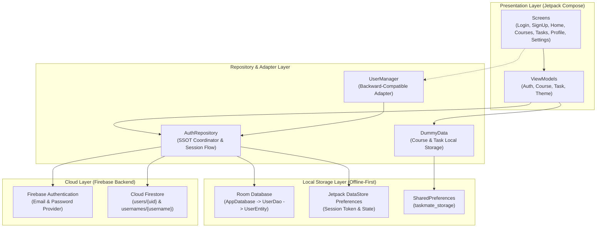

<p align="center">
  
</p>

<h1 align="center">TaskMate</h1>

<p align="center">
  <b>A Modern, Cloud-Synchronized Student Task & Course Management Android Application</b><br>
  <i>Dirancang presisi berbasis Jetpack Compose, Material 3, Hybrid Storage Architecture, dan Firebase</i>
</p>

<p align="center">
  
  
  
  
  
  
</p>

---

## 📌 Ringkasan Akademik

| Informasi Akademik | Detail Keterangan |
| :--- | :--- |
| **Mata Kuliah** | Pemrograman Aplikasi Perangkat Bergerak (PAPB) — Kelas D |
| **Kelompok** | Kelompok 9 |
| **Target Evaluasi** | Proyek Tugas Kelompok & Ujian Akhir Praktikum (UAP) |
| **Pola Arsitektur** | MVVM (Model-View-ViewModel) + Repository Pattern + Clean Architecture |
| **Penyimpanan Data** | **Hybrid Architecture**: Cloud Single Source of Truth + Offline-First Local Cache |

---

## 📋 Daftar Isi
1. [Tentang TaskMate](#-tentang-taskmate)
2. [Arsitektur Sistem (Hybrid Local + Cloud)](#-arsitektur-sistem-hybrid-local--cloud)
3. [Fitur Utama & Modul Aplikasi](#-fitur-utama--modul-aplikasi)
4. [Struktur Database & Keamanan Data](#-struktur-database--keamanan-data)
5. [Pohon Direktori Proyek](#-pohon-direktori-proyek)
6. [Teknologi & Dependensi](#-teknologi--dependensi)
7. [Panduan Instalasi & Menjalankan Proyek](#-panduan-instalasi--menjalankan-proyek)
8. [Hasil Pengujian Unit (Unit Tests)](#-hasil-pengujian-unit-unit-tests)
9. [Tim Pengembang (Kelompok 9)](#-tim-pengembang-kelompok-9)

---

## 💡 Tentang TaskMate

**TaskMate** adalah solusi manajemen jadwal perkuliahan dan tugas akademik mahasiswa yang dibangun secara modern dengan **Jetpack Compose (Material 3)**. Aplikasi ini dirancang untuk menjawab tantangan pengelolaan waktu mahasiswa melalui perpaduan sinkronisasi awan terpusat dan keandalan akses offline.

### 🌟 Nilai Unggulan Aplikasi:
- 🌐 **Sinkronisasi Multi-Perangkat (Cloud)**: Akun pengguna terhubung langsung ke **Firebase Authentication** dan **Cloud Firestore**. Mahasiswa dapat login di perangkat smartphone mana pun dengan data profil yang selalu tersinkronisasi.
- ⚡ **Offline-First & Tangguh Tanpa Koneksi**: Ketika koneksi internet terputus, sesi aktif dan data akademik tetap dapat diakses secara instan melalui **Room Database** dan **DataStore Preferences**.
- 🎨 **Presisi Desain Figma**: Komponen antarmuka (Clock dial time picker, keyboard entry mode, date picker, kartu mata kuliah, dan dashboard statistik) dirancang presisi sesuai mockup UI/UX.
- 🔒 **Standar Keamanan Tinggi**: Tidak menyimpan password pengguna dalam bentuk plaintext di database lokal (Room/SharedPreferences) maupun dokumen Cloud Firestore.

---

## 🏛️ Arsitektur Sistem (Hybrid Local + Cloud)

TaskMate memisahkan tanggung jawab kode secara terstruktur menggunakan prinsip **Clean Architecture** dan **MVVM Pattern**:



### Prinsip Keamanan & Privasi Data:
1. **Zero Plaintext Password**: Password hanya digunakan saat proses autentikasi ke Firebase Auth dan tidak pernah disimpan di storage lokal maupun dokumen Firestore.
2. **Firebase UID sebagai Kunci Utama**: Identitas unik pengguna menggunakan UID resmi dari Firebase Authentication.
3. **Reservasi Atomik Username**: Menjamin keunikan global nama pengguna melalui koleksi `usernames/{usernameLower}` sehingga tidak ada pengguna yang dapat mengambil username akun lain.

---

## 🚀 Fitur Utama & Modul Aplikasi

### 1. 🔐 Autentikasi & Akun Pengguna
- **Pendaftaran Akun (Sign Up)**: Input *Front Name*, *Back Name* (otomatis digabung menjadi *Full Name*), *Username*, *Email*, *Password*, dan *Confirm Password*. Dilengkapi validasi regex, deteksi duplikasi username/email, dan mekanisme rollback otomatis jika proses cloud terganggu.
- **Login Fleksibel**: Mahasiswa dapat masuk menggunakan **Email** maupun **Username**. Sistem secara otomatis meresolusi username ke email akun melalui cloud.
- **Lupa Password (Forgot Password)**: Pengiriman tautan reset password resmi ke email pengguna melalui Firebase Authentication.
- **Persistensi Sesi & Indikator Loading**: Sesi akun tersimpan di DataStore Preferences untuk auto-login saat aplikasi dibuka kembali, dilengkapi `CircularProgressIndicator` visual saat memproses data.

### 2. 📚 Manajemen Mata Kuliah (Courses)
- **Katalog Kuliah Sesuai Figma**: Menampilkan 6 mata kuliah default (*PAPB D, Ruang RV1.3, Dosen Dr. Eng. Herman Tolle, S.T., M.T.*).
- **Multi-Session Scheduling**: Mendukung mata kuliah yang memiliki lebih dari satu sesi pertemuan dalam seminggu (misalnya PAPB D pada hari Selasa dan Jumat).
- **Interactive Time Picker**: Pemilihan jam mulai dan selesai kuliah menggunakan visual Jam Dial (Clock Face) maupun Input Papan Ketik (Keyboard), mendukung format 12-Jam (AM/PM) dan 24-Jam.
- **Operasi CRUD**: Tambah mata kuliah baru (*Add Course*), ubah data (*Edit Course*), dan hapus (*Delete Course*).

### 3. ✅ Manajemen Tugas (Tasks)
- **Monitoring Tenggat Waktu**: Menampilkan sisa hari pengerjaan (*Days Left*), tanggal jatuh tempo (*Due Date*), status tugas (*In Progress* / *Completed*), dan deskripsi lengkap tugas.
- **Combined Date & Time Picker**: Pemilihan tanggal dan jam deadline yang otomatis digabung dalam format terstandarisasi.
- **Dashboard Statistik**: Penghitung tugas selesai (*Finished Tasks Count*) yang terintegrasi langsung dengan kartu statistik di Home Screen.
- **Operasi CRUD**: Tambah tugas baru (*Add Task*), ubah rincian (*Edit Task*), dan hapus tugas (*Delete Task*).

### 4. 📅 Jadwal Mingguan & Kalender (Schedules)
- **Today Schedule**: Menampilkan jadwal kuliah hari ini secara cerdas pada dashboard Home Screen sesuai hari aktif.
- **Weekly Schedule**: Tampilan filter harian (Senin s/d Minggu) untuk perencanaan studi mahasiswa.

### 5. 🎨 Personalisasi & Aksesibilitas
- **Tema Terang & Gelap (Light / Dark Mode)**: Palet warna Material 3 kontras tinggi yang nyaman di mata.
- **Skala Ukuran Teks (Font Size Scaling)**: Opsi ukuran teks *Small (0.85x)*, *Regular (1.0x)*, atau *Large (1.15x)*.
- **Dwibahasa (Localization)**: Dukungan penuh dwibahasa (**Bahasa Indonesia** dan **English**) pada seluruh antarmuka, dialog, dan pesan validasi.

---

## 🗄️ Struktur Database & Keamanan Data

### 1. Skema Cloud Firestore
```
firestore/
├── users/
│   └── {uid}/
│       ├── uid: string
│       ├── username: string
│       ├── email: string
│       ├── fullName: string
│       ├── createdAt: number (ms)
│       └── updatedAt: number (ms)
│
└── usernames/
    └── {usernameLower}/
        ├── uid: string
        └── email: string
```

### 2. Aturan Keamanan Firestore (`firestore.rules`)
- Dokumen profil pengguna `users/{userId}` hanya dapat diakses dan diperbarui oleh pemilik UID bersangkutan (`request.auth.uid == userId`).
- Dilarang keras menyertakan properti `password` ke dalam dokumen Firestore.
- Email profil di-lock agar tidak dapat dimodifikasi sembarangan tanpa melalui flow verifikasi akun.

### 3. Skema Database Lokal Room (`AppDatabase`)
- **Tabel `users` (`UserEntity`)**:
  - `uid` : `String` *(Primary Key)*
  - `username` : `String`
  - `email` : `String`
  - `fullName` : `String`
  - `createdAt` : `Long`

---

## 📂 Pohon Direktori Proyek

```
TaskMate/
├── app/
│   ├── google-services.json              # Konfigurasi koneksi Firebase
│   └── src/
│       ├── main/
│       │   ├── AndroidManifest.xml       # Deklarasi izin INTERNET & Network State
│       │   └── java/com/example/taskmate/
│       │       ├── MainActivity.kt       # Activity utama & inisialisasi tema
│       │       │
│       │       ├── data/
│       │       │   ├── DummyData.kt      # Mock data Course & Task sesuai Figma + SP
│       │       │   ├── UserManager.kt    # Adapter facade backward-compatible
│       │       │   ├── model/
│       │       │   │   └── UserAccount.kt# Domain model akun (aman tanpa password)
│       │       │   ├── local/
│       │       │   │   ├── AppDatabase.kt# Room Database singleton
│       │       │   │   ├── UserLocalDataSource.kt
│       │       │   │   ├── dao/UserDao.kt# Data Access Object Room
│       │       │   │   └── entity/UserEntity.kt
│       │       │   ├── preferences/
│       │       │   │   └── SessionPreferences.kt # DataStore sesi login
│       │       │   ├── remote/
│       │       │   │   ├── UserRemoteDataSource.kt # Firebase Auth & Firestore
│       │       │   │   └── dto/UserDto.kt
│       │       │   └── repository/
│       │       │       └── AuthRepository.kt # Koordinator Hybrid SSOT
│       │       │
│       │       ├── navigation/
│       │       │   ├── Screen.kt         # Definisi rute layar
│       │       │   ├── ButtonNavItem.kt  # Item navigasi BottomBar
│       │       │   └── TaskMateNavGraph.kt # Grafik Navigasi Compose
│       │       │
│       │       └── ui/
│       │           ├── components/       # Komponen UI modular (Cards, Pickers, BottomBar)
│       │           ├── screens/
│       │           │   ├── auth/         # Login, SignUp, ForgotPass, Welcome, Splash
│       │           │   ├── main/         # Home, Courses, Tasks, Schedule, Profile
│       │           │   └── sub/          # Add/Edit Course & Task, Settings, Details
│       │           ├── theme/            # Color, Theme, Type, ThemeState, Localization
│       │           └── viewmodel/        # ViewModels untuk seluruh layar
│       │
│       └── test/java/com/example/taskmate/
│           └── ExampleUnitTest.kt        # 20 skenario uji unit otomatis
│
├── firestore.rules                       # Aturan keamanan Cloud Firestore
├── build.gradle.kts                      # Konfigurasi Gradle root & KSP plugin
└── README.md                             # Dokumentasi resmi proyek
```

---

## 🛠️ Teknologi & Dependensi

| Kategori | Library / Framework | Versi | Peran Utama |
| :--- | :--- | :--- | :--- |
| **Language** | Kotlin | `2.2.10` | Bahasa pemrograman utama |
| **Build Tool** | Android Gradle Plugin (AGP) | `9.4.1` | Sistem kompilasi Android modern |
| **Processor** | Google KSP | `2.0.21-1.0.28` | Pemrosesan anotasi Room & DTO |
| **UI Kit** | Jetpack Compose (Material 3) | BoM `2026.02.01` | Deklaratif UI antarmuka responsif |
| **Navigation** | Navigation Compose | `2.8.5` | Manajemen alur navigasi antar-layar |
| **Cloud Auth** | Firebase Authentication | BoM `33.7.0` | Autentikasi email dan kata sandi |
| **Cloud DB** | Cloud Firestore | BoM `33.7.0` | Database dokumen terpusat cloud |
| **Local DB** | AndroidX Room Database | `2.7.0-alpha13` | Penyimpanan cache offline lokal |
| **Session** | Jetpack DataStore Preferences | `1.1.1` | Penyimpanan token sesi pengguna |
| **Async** | Coroutines & StateFlow | `1.8.1` | Manajemen state asinkronus reaktif |
| **Testing** | JUnit 4 + AndroidX Test | `4.13.2` | Pengujian logika dan validasi unit |

---

## 💻 Panduan Instalasi & Menjalankan Proyek

### 1. Prasyarat Sistem
- **Android Studio**: Android Studio Koala / Ladybug / Meerkat ke atas.
- **JDK**: Eclipse Adoptium JDK 21 (`jdk-21.0.12.101-hotspot`).
- **Android OS**: Perangkat fisik atau emulator dengan Android 8.0 (Oreo / API 26) ke atas.

### 2. Kloning Repository
```bash
git clone https://github.com/HakuCik/Taskmate.git
cd Taskmate
```

### 3. Konfigurasi Firebase Console
1. Buka [Firebase Console](https://console.firebase.google.com/) dan buat project baru.
2. Tambahkan aplikasi Android dengan package name: `com.example.taskmate`.
3. Letakkan file `google-services.json` ke dalam direktori `app/`:
   ```bash
   Taskmate/app/google-services.json
   ```
4. Di Firebase Console:
   - Aktifkan **Authentication** > Sign-in method > **Email/Password**.
   - Aktifkan **Cloud Firestore** dan salin aturan dari [`firestore.rules`](file:///F:/Project/VSCode/Kotlin/PAPB-D-Kelompok-9-TaskMate/firestore.rules).

### 4. Eksekusi Perintah Kompilasi & Pengujian

- **Menjalankan Rangkaian Unit Test**:
  ```bash
  ./gradlew test
  ```
- **Membuat File APK Debug Siap Pasang**:
  ```bash
  ./gradlew assembleDebug
  ```
- File APK hasil build akan otomatis tersedia pada:  
  📁 `app/build/outputs/apk/debug/app-debug.apk`

---

## 🧪 Hasil Pengujian Unit (Unit Tests)

Pengujian otomatis dijalankan menggunakan JUnit 4 pada [`ExampleUnitTest.kt`](file:///F:/Project/VSCode/Kotlin/PAPB-D-Kelompok-9-TaskMate/app/src/test/java/com/example/taskmate/ExampleUnitTest.kt) dengan hasil **20/20 Lulus (100% Pass)**:

| No | Nama Skenario Uji | Domain Pengujian | Status |
| :---: | :--- | :--- | :---: |
| 1 | `addition_isCorrect` | Sanity Check JUnit Environment | ✅ PASS |
| 2 | `fontSizeModes_haveCorrectScales` | Verifikasi Skala Font (Small/Regular/Large) | ✅ PASS |
| 3 | `themeState_fontSizeUpdate` | Pembaruan Reaktif State Tipografi | ✅ PASS |
| 4 | `densityScaling_modifiesPixelSizes` | Konversi SP ke PX Berdasarkan Font Scale | ✅ PASS |
| 5 | `courseTimeHelper_detectsAndTransformsTimeModes` | Deteksi Format 12-Jam & 24-Jam Kuliah | ✅ PASS |
| 6 | `dummyData_matchesFigmaDesign` | Integritas 6 Kuliah & 5 Tugas Sesuai Figma | ✅ PASS |
| 7 | `dummyData_deleteOperations` | Validasi Penghapusan Item Kuliah & Tugas | ✅ PASS |
| 8 | `courseSessions_multiSessionAddUpdateDelete` | Penanganan Jadwal Kuliah Multi-Sesi | ✅ PASS |
| 9 | `courseTimeHelper_normalizesDays` | Normalisasi Penamaan Hari Dwibahasa | ✅ PASS |
| 10 | `courseTimeHelper_parseHourMinuteAndFormatTime` | Parsing Jam & Menit serta Rekonstruksi Waktu | ✅ PASS |
| 11 | `addCourseViewModel_validationAndCombinedInputs` | Validasi Formulir & Penggabungan Nama Dosen | ✅ PASS |
| 12 | `addTaskViewModel_validationAndCombinedDueDate` | Validasi Tugas & Penggabungan Date/Time | ✅ PASS |
| 13 | `dummyData_jsonSerializationLossless` | Serialisasi Lossless JSON SharedPreferences | ✅ PASS |
| 14 | `taskDateHelper_formattingAndParsing` | Parsing String Tanggal Jatuh Tempo Tugas | ✅ PASS |
| 15 | `editTaskViewModel_loadAndValidation` | Pengisian Otomatis & Validasi Ubah Tugas | ✅ PASS |
| 16 | `userManager_defaultAccountsExistAndLoginWorks` | Autentikasi Fallback & Sesi Mahasiswa | ✅ PASS |
| 17 | `userManager_registerNewAccount_successAndPersists` | Pendaftaran Akun Baru & Validasi Sesi | ✅ PASS |
| 18 | `userManager_registerDuplicateFails` | Proteksi Duplikasi Email & Username | ✅ PASS |
| 19 | `loginViewModel_validationsAndSuccess` | Validasi ViewModel Login (Email/Username) | ✅ PASS |
| 20 | `signUpViewModel_validationsAndSuccess` | Validasi ViewModel Pendaftaran & Nama Lengkap | ✅ PASS |

---

## 👥 Tim Pengembang (Kelompok 9)

| No | Nama Mahasiswa | NIM | Peran Utama |
| :---: | :--- | :---: | :--- |
| 1 | **Taqiyuddin Umar** | `245150219111001` | Dokumentasi Sistem & Standardisasi Desain |
| 2 | **Alviensyah Mohammad** | `245150219111002` | UI/UX Jetpack Compose, NavGraph, Hybrid Architecture & Firebase Integration |
| 3 | **Muhammad Naufal Dzakwan** | `245150207111098` | Manajemen Modul Data Course & Schedules |
| 4 | **Michael Asaloei** | `215150201111067` | Manajemen Modul Data Task & Quality Testing |

---

<p align="center">
  <sub>TaskMate — Dikembangkan dengan dedikasi untuk Ujian Akhir Praktikum (UAP) Pemrograman Aplikasi Perangkat Bergerak (PAPB) Kelas D.</sub>
</p>
